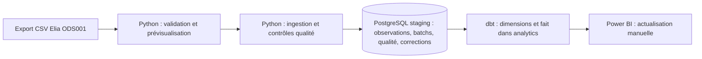

# Belgian Energy Data Pipeline

Pipeline local et reproductible pour analyser la consommation électrique belge à partir des exports [Elia ODS001](https://opendata.elia.be/explore/dataset/ods001/). Il charge les observations dans PostgreSQL, contrôle leur qualité, construit trois tables analytiques avec dbt et les met à disposition d'un rapport Power BI actualisé manuellement.

## Fonctionnement

- Validation des CSV ODS001, normalisation des instants en UTC et identification des fichiers par SHA-256.
- Prévisualisation des différences `NEW`, `UNCHANGED` et `CHANGED`, avec export JSON exhaustif sur demande.
- Ingestion transactionnelle et incrémentale : insertion des nouveautés, conservation des lignes identiques et correction historique uniquement avec un hash et un motif explicites. Les anciennes valeurs sont historisées.
- Contrôles qualité sur le fichier reçu et sur les valeurs consolidées concernées. Les erreurs bloquent l'ingestion ; les avertissements sont conservés avec leur périmètre et leur date de référence.
- Modèles dbt `dim_date`, `dim_time` et `fact_load_15m` dans `analytics`, puis visualisation Power BI.
- Orchestration locale Prefect 3.9.1 : lancement manuel ou surveillance de `data/inbox/`, un CSV par passage, puis classement pour archive, revue ou diagnostic. Le Cron toutes les cinq minutes est livré désactivé ; serveur et worker doivent rester actifs. Voir le [guide Prefect](docs/prefect.md).



Les scripts SQL `01` à `04` créent et font évoluer le schéma `staging` **manuellement** ; Python ne les exécute pas. dbt lit `staging.elia_load` et matérialise ses tables dans `analytics`. Les diagnostics et la prévisualisation ne modifient pas les tables permanentes. Le rapport JSON complet est un fichier local.

## Reproduire localement

Environnement de référence : Windows 11, Python 3.13, PostgreSQL 18, dbt Core 1.11. Depuis la racine du dépôt, dans PowerShell :

```powershell
py -3.13 -m venv .venv
.\.venv\Scripts\python.exe -m pip install -r requirements.txt
py -3.13 -m venv .venv-dbt
.\.venv-dbt\Scripts\python.exe -m pip install -r dbt\requirements.txt
Copy-Item dbt\profiles.yml.example dbt\profiles.yml
```

Créer la base et appliquer les migrations `sql/01_create_schema.sql` à `sql/04_add_incremental_tracking.sql` dans l'ordre, avec un compte autorisé et après revue. Sur une base déjà peuplée, suivre les prérequis propres à chaque migration ; ne pas rejouer aveuglément les scripts. Le profil dbt exemple lit les cinq variables PostgreSQL et cible le schéma `analytics`.

Renseigner `PGHOST`, `PGPORT`, `PGDATABASE`, `PGUSER` et `PGPASSWORD` dans l'environnement du processus ou dans un fichier `.env` local ignoré par Git. Python charge `.env` sans écraser les variables déjà présentes ; dbt lit les variables d'environnement et ne charge pas `.env` lui-même. Ne jamais versionner les identifiants. Placer un export CSV immuable sous `data/raw/` (ignoré par Git). Le chemin par défaut de l'ingestion est `data/raw/ods001.csv`.

## Commandes essentielles

Les commandes ci-dessous partent de la racine du dépôt. Le guide [d'exploitation](docs/operations.md) détaille les paramètres, les écritures, les diagnostics et les précautions.

```powershell
# Lecture : différences résumées, puis rapport exhaustif local
.\.venv\Scripts\python.exe -B src/merge_ods001.py data/raw/new_export.csv --sample-size 5
.\.venv\Scripts\python.exe -B src/merge_ods001.py data/raw/new_export.csv --full-report --output data/processed/preview_full.json

# Écriture dans staging : ingestion sans correction historique autorisée
.\.venv\Scripts\python.exe -B src/ingest_ods001.py data/raw/new_export.csv --input-scope partial

# Précontrôle en lecture seule, puis reconstruction protégée dans analytics
.\.venv\Scripts\python.exe -B src/dbt_guard.py --check-only
.\.venv\Scripts\python.exe -B src/dbt_guard.py

# Validation locale sans ingestion ni reconstruction dbt
.\.venv\Scripts\python.exe -B -m pytest -p no:cacheprovider -m 'not integration' -ra
.\.venv\Scripts\ruff.exe check --no-cache .
.\.venv\Scripts\ruff.exe format --check --no-cache .
```

Une réexécution du **même fichier** déjà enregistré `SUCCESS` est ignorée grâce au SHA-256. Un fichier de contenu différent mais aux observations identiques peut créer un nouveau batch `SUCCESS` avec zéro insertion. Pour une correction, examiner le rapport complet puis fournir le hash exact et un motif selon le [guide des corrections](docs/authorized_corrections.md). Ne pas réutiliser une autorisation dans une tâche récurrente.

L'API Python `ingest_csv()` renvoie `IngestionResult` après une ingestion réussie : `batch_id` identifie le batch, `rows_received` compte les observations acceptées, `rows_inserted` les nouvelles, `rows_unchanged` les identiques et `rows_updated` les corrections autorisées. Ces compteurs décrivent le résultat validé en base. Un fichier déjà traité avec succès renvoie `None` sans créer de batch ; une erreur continue de lever une exception. La CLI affiche toujours le nombre d'observations acceptées pour un nouveau batch.

## Documentation

| Sujet | Guide |
| --- | --- |
| Installation, commandes et suivi des batchs | [Exploitation](docs/operations.md) |
| Serveur, worker, deployments et cycle de vie des CSV | [Prefect](docs/prefect.md) |
| Règles, périmètres et constats de qualité | [Qualité des données](docs/data_quality.md) |
| Prévisualisation et rapport complet | [Prévisualisation](docs/incremental_preview.md) |
| Autorisation et historisation des corrections | [Corrections](docs/authorized_corrections.md) |
| Configuration et modèles analytiques | [dbt](docs/dbt_setup.md), [dimensions temporelles](docs/temporal_dimensions.md), [fait de charge](docs/fact_load_15m.md) |
| Tests PostgreSQL et base dédiée | [Tests d'intégration](docs/integration_tests.md) |
| Contrats et validations antérieurs | [Contrat du schéma](docs/incremental_contract.md), [ingestion incrémentale](docs/incremental_ingestion.md), [validation des deux périmètres](docs/phase_d_acceptance.md) |

## État et limites

Une ingestion réelle du **26 octobre 2026** a traité 415 104 observations : 768 insérées, 413 276 inchangées et 1 060 corrigées avec historique (`batch_id=2`, `SUCCESS`). La reconstruction des trois modèles dbt et leurs 46 tests a réussi ; Power BI a été actualisé manuellement. Ces chiffres sont un résultat daté, pas une valeur attendue par chaque exécution. Le rapport de cette ingestion compte 1 854 occurrences `WARNING` sur deux périmètres ; voir [qualité des données](docs/data_quality.md) pour éviter le double comptage.

L'acquisition des exports et l'actualisation Power BI restent manuelles. Prefect permet de planifier le traitement local des CSV déposés ; son Cron est initialement désactivé. Il n'y a ni cloud ni SLA de fraîcheur Elia validé. Les statistiques de qualité sur de grands fichiers peuvent consommer beaucoup de mémoire. L'historique des corrections conserve les anciennes valeurs, mais l'appartenance complète de chaque ligne à tous ses exports antérieurs n'est pas reconstruite depuis la seule table courante. Les prochaines évolutions envisageables sont l'acquisition automatisée, la surveillance de fraîcheur après validation d'un seuil et l'évaluation de volumes plus importants.

### Verrou partagé ingestion / dbt

`pipeline_lock.pipeline_lock(conn)` centralise le verrou PostgreSQL exclusif de
session `(81001, 1)`. L'ingestion conserve son interface `ingestion_lock`.
Le délai `PIPELINE_LOCK_TIMEOUT` (10 secondes par défaut) est appliqué localement
à la transaction d'acquisition ; les commits et rollbacks ultérieurs ne libèrent
pas le verrou de session. Le contexte annule toute transaction encore ouverte
avant de libérer le verrou : valider explicitement les écritures à conserver.

Le prochain orchestrateur pourra utiliser :

```python
from dbt_guard import locked_build
import dbt_run_store

with locked_build() as session:
    # Déterminer le batch cible via session.connection, puis terminer la
    # transaction de lecture avant les écritures du store sur sa connexion.
    target_batch_id = ...
    session.connection.commit()
    attempt = dbt_run_store.start_build(target_batch_id)
    session.build()  # attend la fin du sous-processus sous le même verrou
    dbt_run_store.mark_success(attempt.build_id)
```

Cet exemple illustre le périmètre de protection, pas la gestion complète des
échecs : enregistrer également FAILED dans ce contexte si le lancement échoue.
Les méthodes actuelles du store ouvrent et valident leurs propres transactions,
sans acquérir de verrou pipeline. Elles restent donc protégées par la session
parente. Ne pas rappeler `guarded_build()` ou `locked_build()` dans ce contexte :
utiliser `session.build()` pour éviter d'attendre son propre verrou sur une autre
connexion. Ne pas garder de verrous de lignes non validés sur `session.connection`
pendant un appel au store. La connexion exposée permet aussi d'intégrer plus tard
les opérations de suivi directement sur cette connexion, sans nouvelle acquisition.

Le verrou est coopératif : un dbt lancé directement le contourne. Si le parent
est tué brutalement ou perd sa connexion PostgreSQL alors que dbt continue,
PostgreSQL libère le verrou sans garantir l'arrêt du sous-processus ; une autre
exécution peut alors commencer. Cette limite nécessite une supervision des
processus si une garantie au-delà de la durée de vie du parent devient nécessaire.

Les tests `tests/integration/test_pipeline_lock.py` simulent dbt et exigent les
cinq variables `TEST_PGHOST`, `TEST_PGPORT`, `TEST_PGDATABASE`, `TEST_PGUSER`,
`TEST_PGPASSWORD`. La fixture refuse toute base autre que `belgian_energy_test`.

## Pipeline local complet

Depuis la racine du dépôt, avec les migrations 01 à 05 appliquées et
l'environnement configuré selon `docs/dbt_setup.md` :

```powershell
.\.venv\Scripts\python.exe -B src/local_pipeline.py data/raw/ods001.csv
```

Prévisualiser un nouvel export sans ingestion ni dbt et examiner ses différences :

```powershell
.\.venv\Scripts\python.exe -B src/orchestration_preview.py data/raw/new_export.csv
.\.venv\Scripts\python.exe -B src/merge_ods001.py data/raw/new_export.csv --full-report --output data/processed/preview_full.json
```

Sans autorisation, les corrections historiques arrêtent le pipeline avec
`AWAITING_APPROVAL` et le code CLI 1 : aucune observation nouvelle ou corrigée
de cet export n'est appliquée et dbt n'est pas lancé. Après vérification manuelle
du rapport et du fichier exact, fournir son SHA-256 (`file_sha256` de la
prévisualisation, 64 caractères hexadécimaux minuscules) et un motif non vide :

```powershell
.\.venv\Scripts\python.exe -B src/local_pipeline.py data/raw/new_export.csv --authorize-sha256 "HASH_DU_FICHIER_VERIFIE" --correction-reason "Corrections historiques Elia vérifiées"
```

Les options `--extracted-at "2025-02-01T12:00:00+01:00"` (date d'extraction avec
fuseau explicite) et `--source-reference "Référence de l'export Elia"` sont
facultatives. L'autorisation reste manuelle et liée au contenu exact du fichier ;
ne pas la réutiliser dans une tâche récurrente. Une autorisation incomplète, mal
formée ou liée à un autre hash est refusée. L'ingestion revérifie le hash et
recalcule les différences sous verrou ; elle conserve tous ses contrôles de
qualité et de fraîcheur. Les observations nouvelles et les corrections avec
leur historique sont validées dans la même transaction. Voir aussi le
[guide des corrections](docs/authorized_corrections.md).

Le pipeline recalcule ensuite la synchronisation analytique sous le verrou partagé
`(81001, 1)` via `locked_build()`. Une reconstruction déjà en attente n'empêche
pas une nouvelle ingestion. Le batch cible, le début et la confirmation de la
tentative dbt utilisent la connexion qui détient ce verrou. Chaque appel exécute
au maximum un `dbt build`, suivi `RUNNING` puis `SUCCESS` ou `FAILED`.

La sortie JSON expose `status`, `ingestion_batch_id`, `target_batch_id`, `build_id`,
une catégorie d'erreur éventuelle, `rows_new` et `rows_changed`. Ces deux compteurs
indiquent les différences prévisualisées pour `AWAITING_APPROVAL`, ou les insertions
et corrections validées pour une nouvelle ingestion (même si dbt échoue ensuite).
Ils valent `null` si ces informations sont indisponibles, notamment pour un fichier
déjà ingéré ou des corrections apparues après la prévisualisation.

Les statuts restent `NO_CHANGE`, `SUCCESS`, `AWAITING_APPROVAL` et `DBT_FAILED`.
Les deux derniers retournent le code CLI 1 ; les exceptions techniques et les
arguments d'autorisation invalides sont traités par la frontière CLI sécurisée
existante (code 1, interruption 130, sans détails de connexion). Les logs vont
sur stderr. Pour un extrait volontairement discontinu, `--input-scope partial`
réutilise le contrôle existant.

L'ingestion et dbt acquièrent successivement le même verrou, sans acquisition
imbriquée. Un autre processus peut intervenir entre ces phases : l'ingestion
reclasse donc le fichier sous son verrou et dbt relit l'état après acquisition.
Un fichier déjà connu est revérifié par l'ingestion, qui le saute sans nouveau
batch. Un CSV refusé arrête cet appel avant dbt.

En cas d'échec dbt, le batch ingéré et les corrections historisées restent validés.
Relancer le même fichier permet de retenter dbt sans réappliquer les corrections
ni fournir de nouvelle autorisation. Après succès, un nouveau lancement retourne
`NO_CHANGE` si la synchronisation est à jour. Un échec de préflight ou d'acquisition
du verrou intervient avant la création d'une tentative. Un arrêt brutal peut
laisser une tentative `RUNNING` ; elle ne compte jamais comme un succès et le
prochain appel peut reconstruire. Si dbt réussit mais que l'enregistrement final
échoue, le prochain appel peut reconstruire à nouveau. La couche
[Prefect](docs/prefect.md) ajoute la planification et la surveillance de dossier.
Les opérations métier restent sans retries automatiques.
