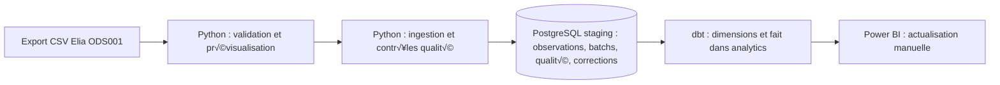

# Belgian Energy Data Pipeline

Pipeline local et reproductible pour analyser la consommation électrique belge à partir des exports [Elia ODS001](https://opendata.elia.be/explore/dataset/ods001/). Il charge les observations dans PostgreSQL, contrôle leur qualité, construit trois tables analytiques avec dbt et les met à disposition d'un rapport Power BI actualisé manuellement.

## Fonctionnement

- Validation des CSV ODS001, normalisation des instants en UTC et identification des fichiers par SHA-256.
- Prévisualisation des différences `NEW`, `UNCHANGED` et `CHANGED`, avec export JSON exhaustif sur demande.
- Ingestion transactionnelle et incrémentale : insertion des nouveautés, conservation des lignes identiques et correction historique uniquement avec un hash et un motif explicites. Les anciennes valeurs sont historisées.
- Contrôles qualité sur le fichier reçu et sur les valeurs consolidées concernées. Les erreurs bloquent l'ingestion ; les avertissements sont conservés avec leur périmètre et leur date de référence.
- Modèles dbt `dim_date`, `dim_time` et `fact_load_15m` dans `analytics`, puis visualisation Power BI.



Les scripts SQL `01` à `04` créent et font évoluer le schéma `staging` **manuellement** ; Python ne les exécute pas. dbt lit `staging.elia_load` et matérialise ses tables dans `analytics`. Les diagnostics et la prévisualisation ne modifient pas les tables permanentes. Le rapport JSON complet est un fichier local.

## Reproduire localement

Environnement de référence : Windows 11, Python 3.13, PostgreSQL 18, dbt Core 1.11. Depuis la racine du dépôt, dans PowerShell :

```powershell
py -3.13 -m venv .venv
.\.venv\Scripts\python.exe -m pip install -r requirements.txt
py -3.13 -m venv .venv-dbt
.\.venv-dbt\Scripts\python.exe -m pip install -r dbt\requirements.txt
Copy-Item dbt\profiles.yml.example dbt\profiles.yml
```

Créer la base et appliquer les migrations `sql/01_create_schema.sql` à `sql/04_add_incremental_tracking.sql` dans l'ordre, avec un compte autorisé et après revue. Sur une base déjà peuplée, suivre les prérequis propres à chaque migration ; ne pas rejouer aveuglément les scripts. Le profil dbt exemple lit les cinq variables PostgreSQL et cible le schéma `analytics`.

Renseigner `PGHOST`, `PGPORT`, `PGDATABASE`, `PGUSER` et `PGPASSWORD` dans l'environnement du processus ou dans un fichier `.env` local ignoré par Git. Python charge `.env` sans écraser les variables déjà présentes ; dbt lit les variables d'environnement et ne charge pas `.env` lui-même. Ne jamais versionner les identifiants. Placer un export CSV immuable sous `data/raw/` (ignoré par Git). Le chemin par défaut de l'ingestion est `data/raw/ods001.csv`.

## Commandes essentielles

Les commandes ci-dessous partent de la racine du dépôt. Le guide [d'exploitation](docs/operations.md) détaille les paramètres, les écritures, les diagnostics et les précautions.

```powershell
# Lecture : différences résumées, puis rapport exhaustif local
.\.venv\Scripts\python.exe -B src/merge_ods001.py data/raw/new_export.csv --sample-size 5
.\.venv\Scripts\python.exe -B src/merge_ods001.py data/raw/new_export.csv --full-report --output data/processed/preview_full.json

# Écriture dans staging : ingestion sans correction historique autorisée
.\.venv\Scripts\python.exe -B src/ingest_ods001.py data/raw/new_export.csv --input-scope partial

# Précontrôle en lecture seule, puis reconstruction protégée dans analytics
.\.venv\Scripts\python.exe -B src/dbt_guard.py --check-only
.\.venv\Scripts\python.exe -B src/dbt_guard.py

# Validation locale sans ingestion ni reconstruction dbt
.\.venv\Scripts\python.exe -B -m pytest -p no:cacheprovider -m 'not integration' -ra
.\.venv\Scripts\ruff.exe check --no-cache .
.\.venv\Scripts\ruff.exe format --check --no-cache .
```

Une réexécution du **même fichier** déjà enregistré `SUCCESS` est ignorée grâce au SHA-256. Un fichier de contenu différent mais aux observations identiques peut créer un nouveau batch `SUCCESS` avec zéro insertion. Pour une correction, examiner le rapport complet puis fournir le hash exact et un motif selon le [guide des corrections](docs/authorized_corrections.md). Ne pas réutiliser une autorisation dans une tâche récurrente.

L'API Python `ingest_csv()` renvoie `IngestionResult` après une ingestion réussie : `batch_id` identifie le batch, `rows_received` compte les observations acceptées, `rows_inserted` les nouvelles, `rows_unchanged` les identiques et `rows_updated` les corrections autorisées. Ces compteurs décrivent le résultat validé en base. Un fichier déjà traité avec succès renvoie `None` sans créer de batch ; une erreur continue de lever une exception. La CLI affiche toujours le nombre d'observations acceptées pour un nouveau batch.

## Documentation

| Sujet | Guide |
| --- | --- |
| Installation, commandes et suivi des batchs | [Exploitation](docs/operations.md) |
| Règles, périmètres et constats de qualité | [Qualité des données](docs/data_quality.md) |
| Prévisualisation et rapport complet | [Prévisualisation](docs/incremental_preview.md) |
| Autorisation et historisation des corrections | [Corrections](docs/authorized_corrections.md) |
| Configuration et modèles analytiques | [dbt](docs/dbt_setup.md), [dimensions temporelles](docs/temporal_dimensions.md), [fait de charge](docs/fact_load_15m.md) |
| Tests PostgreSQL et base dédiée | [Tests d'intégration](docs/integration_tests.md) |
| Contrats et validations antérieurs | [Contrat du schéma](docs/incremental_contract.md), [ingestion incrémentale](docs/incremental_ingestion.md), [validation des deux périmètres](docs/phase_d_acceptance.md) |

## État et limites

Une ingestion réelle du **26 octobre 2026** a traité 415 104 observations : 768 insérées, 413 276 inchangées et 1 060 corrigées avec historique (`batch_id=2`, `SUCCESS`). La reconstruction des trois modèles dbt et leurs 46 tests a réussi ; Power BI a été actualisé manuellement. Ces chiffres sont un résultat daté, pas une valeur attendue par chaque exécution. Le rapport de cette ingestion compte 1 854 occurrences `WARNING` sur deux périmètres ; voir [qualité des données](docs/data_quality.md) pour éviter le double comptage.

L'acquisition des exports, le déclenchement du pipeline et l'actualisation Power BI restent manuels. Il n'y a ni ordonnanceur, ni cloud, ni SLA de fraîcheur Elia validé. Les statistiques de qualité sur de grands fichiers peuvent consommer beaucoup de mémoire. L'historique des corrections conserve les anciennes valeurs, mais l'appartenance complète de chaque ligne à tous ses exports antérieurs n'est pas reconstruite depuis la seule table courante. Les prochaines évolutions envisageables sont l'acquisition automatisée, la surveillance de fraîcheur après validation d'un seuil, l'orchestration et l'évaluation de volumes plus importants.

### Verrou partagÈ ingestion / dbt

`pipeline_lock.pipeline_lock(conn)` centralise le verrou PostgreSQL exclusif de
session `(81001, 1)`. L'ingestion conserve son interface `ingestion_lock`.
Le dÈlai `PIPELINE_LOCK_TIMEOUT` (10 secondes par dÈfaut) est appliquÈ localement
‡ la transaction d'acquisition ; les commits et rollbacks ultÈrieurs ne libËrent
pas le verrou de session. Le contexte annule toute transaction encore ouverte
avant de libÈrer le verrou : valider explicitement les Ècritures ‡ conserver.

Le prochain orchestrateur pourra utiliser :

```python
from dbt_guard import locked_build
import dbt_run_store

with locked_build() as session:
    # DÈterminer le batch cible via session.connection, puis terminer la
    # transaction de lecture avant les Ècritures du store sur sa connexion.
    target_batch_id = ...
    session.connection.commit()
    attempt = dbt_run_store.start_build(target_batch_id)
    session.build()  # attend la fin du sous-processus sous le mÍme verrou
    dbt_run_store.mark_success(attempt.build_id)
```

Cet exemple illustre le pÈrimËtre de protection, pas la gestion complËte des
Èchecs : enregistrer Ègalement FAILED dans ce contexte si le lancement Èchoue.
Les mÈthodes actuelles du store ouvrent et valident leurs propres transactions,
sans acquÈrir de verrou pipeline. Elles restent donc protÈgÈes par la session
parente. Ne pas rappeler `guarded_build()` ou `locked_build()` dans ce contexte :
utiliser `session.build()` pour Èviter d'attendre son propre verrou sur une autre
connexion. Ne pas garder de verrous de lignes non validÈs sur `session.connection`
pendant un appel au store. La connexion exposÈe permet aussi d'intÈgrer plus tard
les opÈrations de suivi directement sur cette connexion, sans nouvelle acquisition.

Le verrou est coopÈratif : un dbt lancÈ directement le contourne. Si le parent
est tuÈ brutalement ou perd sa connexion PostgreSQL alors que dbt continue,
PostgreSQL libËre le verrou sans garantir l'arrÍt du sous-processus ; une autre
exÈcution peut alors commencer. Cette limite nÈcessite une supervision des
processus si une garantie au-del‡ de la durÈe de vie du parent devient nÈcessaire.

Les tests `tests/integration/test_pipeline_lock.py` simulent dbt et exigent les
cinq variables `TEST_PGHOST`, `TEST_PGPORT`, `TEST_PGDATABASE`, `TEST_PGUSER`,
`TEST_PGPASSWORD`. La fixture refuse toute base autre que `belgian_energy_test`.
