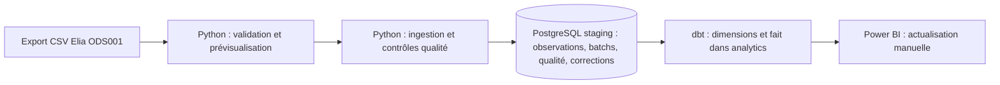

# Belgian Energy Data Pipeline

Pipeline local et reproductible pour analyser la consommation électrique belge à partir des exports [Elia ODS001](https://opendata.elia.be/explore/dataset/ods001/). Il charge les observations dans PostgreSQL, contrôle leur qualité, construit trois tables analytiques avec dbt et les met à disposition d'un rapport Power BI actualisé manuellement.

## Fonctionnement

- Validation des CSV ODS001, normalisation des instants en UTC et identification des fichiers par SHA-256.
- Prévisualisation des différences `NEW`, `UNCHANGED` et `CHANGED`, avec export JSON exhaustif sur demande.
- Ingestion transactionnelle et incrémentale : insertion des nouveautés, conservation des lignes identiques et correction historique uniquement avec un hash et un motif explicites. Les anciennes valeurs sont historisées.
- Contrôles qualité sur le fichier reçu et sur les valeurs consolidées concernées. Les erreurs bloquent l'ingestion ; les avertissements sont conservés avec leur périmètre et leur date de référence.
- Modèles dbt `dim_date`, `dim_time` et `fact_load_15m` dans `analytics`, puis visualisation Power BI.



Les scripts SQL `01` à `04` créent et font évoluer le schéma `staging` **manuellement** ; Python ne les exécute pas. dbt lit `staging.elia_load` et matérialise ses tables dans `analytics`. Les diagnostics et la prévisualisation ne modifient pas les tables permanentes. Le rapport JSON complet est un fichier local.

## Reproduire localement

Environnement de référence : Windows 11, Python 3.13, PostgreSQL 18, dbt Core 1.11. Depuis la racine du dépôt, dans PowerShell :

```powershell
py -3.13 -m venv .venv
.\.venv\Scripts\python.exe -m pip install -r requirements.txt
py -3.13 -m venv .venv-dbt
.\.venv-dbt\Scripts\python.exe -m pip install -r dbt\requirements.txt
Copy-Item dbt\profiles.yml.example dbt\profiles.yml
```

Créer la base et appliquer les migrations `sql/01_create_schema.sql` à `sql/04_add_incremental_tracking.sql` dans l'ordre, avec un compte autorisé et après revue. Sur une base déjà peuplée, suivre les prérequis propres à chaque migration ; ne pas rejouer aveuglément les scripts. Le profil dbt exemple lit les cinq variables PostgreSQL et cible le schéma `analytics`.

Renseigner `PGHOST`, `PGPORT`, `PGDATABASE`, `PGUSER` et `PGPASSWORD` dans l'environnement du processus ou dans un fichier `.env` local ignoré par Git. Python charge `.env` sans écraser les variables déjà présentes ; dbt lit les variables d'environnement et ne charge pas `.env` lui-même. Ne jamais versionner les identifiants. Placer un export CSV immuable sous `data/raw/` (ignoré par Git). Le chemin par défaut de l'ingestion est `data/raw/ods001.csv`.

## Commandes essentielles

Les commandes ci-dessous partent de la racine du dépôt. Le guide [d'exploitation](docs/operations.md) détaille les paramètres, les écritures, les diagnostics et les précautions.

```powershell
# Lecture : différences résumées, puis rapport exhaustif local
.\.venv\Scripts\python.exe -B src/merge_ods001.py data/raw/new_export.csv --sample-size 5
.\.venv\Scripts\python.exe -B src/merge_ods001.py data/raw/new_export.csv --full-report --output data/processed/preview_full.json

# Écriture dans staging : ingestion sans correction historique autorisée
.\.venv\Scripts\python.exe -B src/ingest_ods001.py data/raw/new_export.csv --input-scope partial

# Précontrôle en lecture seule, puis reconstruction protégée dans analytics
.\.venv\Scripts\python.exe -B src/dbt_guard.py --check-only
.\.venv\Scripts\python.exe -B src/dbt_guard.py

# Validation locale sans ingestion ni reconstruction dbt
.\.venv\Scripts\python.exe -B -m pytest -p no:cacheprovider -m 'not integration' -ra
.\.venv\Scripts\ruff.exe check --no-cache .
.\.venv\Scripts\ruff.exe format --check --no-cache .
```

Une réexécution du **même fichier** déjà enregistré `SUCCESS` est ignorée grâce au SHA-256. Un fichier de contenu différent mais aux observations identiques peut créer un nouveau batch `SUCCESS` avec zéro insertion. Pour une correction, examiner le rapport complet puis fournir le hash exact et un motif selon le [guide des corrections](docs/authorized_corrections.md). Ne pas réutiliser une autorisation dans une tâche récurrente.

## Documentation

| Sujet | Guide |
| --- | --- |
| Installation, commandes et suivi des batchs | [Exploitation](docs/operations.md) |
| Règles, périmètres et constats de qualité | [Qualité des données](docs/data_quality.md) |
| Prévisualisation et rapport complet | [Prévisualisation](docs/incremental_preview.md) |
| Autorisation et historisation des corrections | [Corrections](docs/authorized_corrections.md) |
| Configuration et modèles analytiques | [dbt](docs/dbt_setup.md), [dimensions temporelles](docs/temporal_dimensions.md), [fait de charge](docs/fact_load_15m.md) |
| Tests PostgreSQL et base dédiée | [Tests d'intégration](docs/integration_tests.md) |
| Contrats et validations antérieurs | [Contrat du schéma](docs/incremental_contract.md), [ingestion incrémentale](docs/incremental_ingestion.md), [validation des deux périmètres](docs/phase_d_acceptance.md) |

## État et limites

Une ingestion réelle du **26 octobre 2026** a traité 415 104 observations : 768 insérées, 413 276 inchangées et 1 060 corrigées avec historique (`batch_id=2`, `SUCCESS`). La reconstruction des trois modèles dbt et leurs 46 tests a réussi ; Power BI a été actualisé manuellement. Ces chiffres sont un résultat daté, pas une valeur attendue par chaque exécution. Le rapport de cette ingestion compte 1 854 occurrences `WARNING` sur deux périmètres ; voir [qualité des données](docs/data_quality.md) pour éviter le double comptage.

L'acquisition des exports, le déclenchement du pipeline et l'actualisation Power BI restent manuels. Il n'y a ni ordonnanceur, ni cloud, ni SLA de fraîcheur Elia validé. Les statistiques de qualité sur de grands fichiers peuvent consommer beaucoup de mémoire. L'historique des corrections conserve les anciennes valeurs, mais l'appartenance complète de chaque ligne à tous ses exports antérieurs n'est pas reconstruite depuis la seule table courante. Les prochaines évolutions envisageables sont l'acquisition automatisée, la surveillance de fraîcheur après validation d'un seuil, l'orchestration et l'évaluation de volumes plus importants.
